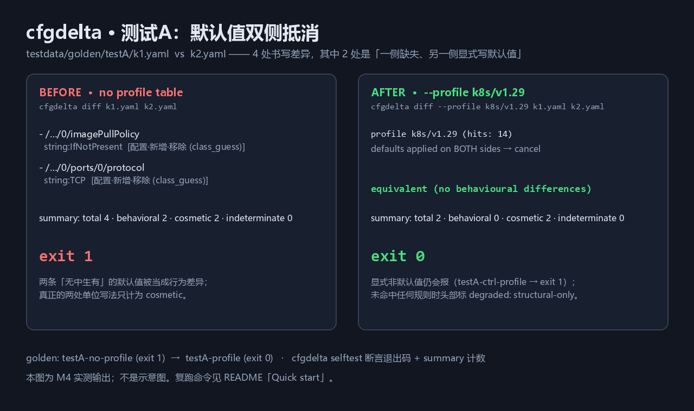

# cfgdelta

**Behavioral config diff — a normalization layer + impact-classification layer for Kubernetes-adjacent config files.**

`cfgdelta` answers one question: *do these two config files behave the same?* Not "are they written the same" — **behave** the same.

It normalizes first (quantities, durations, numerics, YAML booleans), compares structure-independently (key order / indentation / quotes / comments are zero-noise), cancels Kubernetes API-server defaulting on **both** sides, and classifies what remains into five behavioural impact classes plus one cosmetic class that is only counted.

> Status: **v0.1.0** (2026-10-20). The CLI, exit-code contract, parsers (YAML/JSON/TOML/INI/.env/HCL), normalization algebra, structural diff, defaulting profile (both-sides application, cancellation, degraded header), impact classification (six classes, semver sub-classes, gate semantics) and golden harness are in place and pass their tests. See `plan/05-里程碑与验收.md` for the milestone table.

## Milestone status

| 里程碑 | 状态 | 说明 |
|---|---|---|
| M0 | ✅ 完成（2026-10-20） | 骨架 + 装订 + 布局门 + CI（本地等价校验，未接远端） |
| M1 | ✅ 完成（2026-10-20） | golden 29 例 + 三家基线留档（40 个原样 `.out`）+ 10 条默认值逐条核对到上游源码 |
| M2 | ✅ 完成（2026-10-20） | normalize 引擎：测试C 七组全等、`1Gi≠1000M` 反例、`MB/MiB` indeterminate、浮点静态门、双跑字节一致；golden 35 例（33 pass / 2 显式 skip） |
| M3 | ✅ 完成（2026-10-20） | 结构无关比较：键序/缩进/引号/注释四类噪声零条目、序列三模式（ordered/set/keyed）、RFC 6901 路径转义；golden 45 例（43 pass / 2 显式 skip） |
| M4 | ✅ 完成（2026-10-20） | 默认值双侧施加 + 抵消 + 未命中降级：测试A 4 → 0（`testA-profile` exit 0，cosmetic 2）；显式非默认仍报（`testA-ctrl-profile` exit 1）；10 条规则逐条 golden；`testM4` 21 例；golden 66 例（64 pass / 2 显式 skip） |
| M5 | ✅ 完成（2026-10-20） | 分类门禁 + 多格式：六类各一例端到端、semver 四例；TOML/INI/.env/HCL 按扩展名分派；HCL 表达式 `unevaluated_expression`；测试B 在 `keyed:name` 下 0 行为差异；golden 76 例（76 pass / 0 skip）；首屏对照截图落盘 |
| M6 | ✅ 完成（2026-10-20） | 发布三件套：tag `v0.1.0` + GitHub Release（三平台二进制 + `SHA256SUMS`）+ `plan/RELEASE-M6.md` |

This status line describes **version + capability only**. Whether the repository is actually published, and whether CI is green, live on the Releases page and in `plan/` — a README in a tarball should not be the first-hand source for release state.

## Why

Structural diff tools are crowded. The *value-equivalence* layer is empty: the widely used tools report `1Gi` vs `1024Mi`, `500m` vs `0.5`, and API-server-applied defaults as real differences, turning a CI gate red for a no-op change. `cfgdelta` is a **pre-normalization + impact-classification layer** in front of that problem — it is not another YAML pretty-printer.

## Install

```bash
# Go 1.24+ required to build. Produces one static binary, no runtime dependencies.
CGO_ENABLED=0 go build -trimpath -ldflags "-s -w" -o cfgdelta ./cmd/cfgdelta
```

Release binaries for three platforms plus `SHA256SUMS` are attached to GitHub Releases (from M6).

## 30-second tour

```bash
# 1. Exact rational normalization — no floating point anywhere on the comparison path.
$ cfgdelta normalize --at limits/memory --family quantity testdata/golden/testC/c01-left.yaml
quantity:1073741824/1

# 2. Without the defaults table, defaults and unit spellings show up as findings.
$ cfgdelta diff testdata/golden/testA/k1.yaml testdata/golden/testA/k2.yaml; echo $?
1

# 3. With the defaults table applied to BOTH sides, the four findings collapse.
$ cfgdelta diff --profile k8s/v1.29 testdata/golden/testA/k1.yaml testdata/golden/testA/k2.yaml; echo $?
0

# 4. A CI gate that only blocks the classes you care about.
$ cfgdelta gate --fail-on 资源·收缩,接口·暴露 left.yaml right.yaml; echo $?
```

> **Path arguments are written without a leading slash** (`--at limits/memory`, not `--at /limits/memory`).
> Both forms work, but Git Bash / MSYS2 silently rewrites a leading `/` into a Windows drive path
> before the program ever sees it. If you must write the leading slash, set `MSYS2_ARG_CONV_EXCL="*"`
> for that invocation. `cfgdelta` detects the rewritten form and tells you what happened instead of
> failing with a bare "matched no node".



The image above is the M4/M5 golden output, not an illustration: `testA-no-profile` exits `1`
(`total 4 · behavioral 2 · cosmetic 2`), `testA-profile` exits `0`
(`total 2 · behavioral 0 · cosmetic 2`). Both are asserted by `cfgdelta selftest`.

## Exit codes (defined once, asserted per-code)

| Code | Meaning |
|---|---|
| `0` | Equivalent — no behavioural differences |
| `1` | Behavioural difference present (or a class listed in `--fail-on` matched) |
| `2` | Indeterminate result present (`--allow-indeterminate` suppresses) |
| `3` | Parse error or usage error |

Priority: `3 > 2 > 1 > 0`.

## Value families

| Family | Grammar / rule | Canonical form |
|---|---|---|
| `quantity` | Kubernetes apimachinery: `Ki Mi Gi Ti Pi Ei` (1024ⁿ) ∪ `n u m "" k M G T P E` (10ⁿ) ∪ exponent | Exact `big.Rat`, e.g. `quantity:1073741824/1` |
| `duration` | Go `time.ParseDuration` (`ns us µs ms s m h`, composable) | `int64` nanoseconds |
| `decimal` | Exact decimal incl. exponent; `1.0 ≡ 1`, `1e3 ≡ 1000`, `1.50 ≡ 1.5` | Exact `big.Rat` |
| `bool` | YAML 1.1 full family (`yes/on/TRUE/…`) — **plain scalars only** | `true` / `false` |
| `null` | Three states kept strictly apart: absent / explicit null / empty string | `null:absent` etc. |
| `ratio` | **Off by default** (`50%` is a string); opt in via `--coerce-at …=ratio` | Exact `big.Rat` |

`1Gi ≠ 1000M` (1024³ ≠ 1000³) and `1MB` vs `1MiB` is **indeterminate** (`ambiguous_unit_family`), never silently equal.

**No floating point is allowed to take part in any equality decision.** A static guard (`tests/invariants_test.go`) fails the build if `float32`/`float64` appears anywhere under `internal/`.

## Known limitations (honest boundaries)

- **The defaults table is a long-term liability.** It ships as a *versioned* JSON profile (`data/profiles/k8s/v1.29.json`) with **10 high-frequency rules only — not a complete Kubernetes defaulting table**. Defaults change between Kubernetes versions; a new version gets a new file, never an in-place edit. Unknown profile versions are a hard error (`3`), never a silent fallback.
- **When a profile matches nothing, `cfgdelta` says so**: the output header carries `degraded: structural-only`. It never pretends defaulting happened.
- **`indeterminate` is a first-class result, not an error.** It always carries a reason code. Unknown value families are compared as-is by default; only `--strict` upgrades them, so the tool does not become noisy.
- **No sequence auto-detection.** `ordered` / `set` / `keyed:<field>` is chosen explicitly. In `keyed:` mode a duplicate key is a hard error, never "take the first one".
- **No fuzzy matching, no similarity scoring, no heuristic alignment** — those turn "uncertain" into "no difference".
- **No cluster interaction.** No kubectl, no helm, no API server, no kubeconfig. Defaults come from public manifest semantics, not from probing a cluster.
- **No auto-fix.** No patches, no file rewriting, no "you should change X".
- **Formats are dispatched by extension, explicitly.** `.yaml/.yml`, `.json`, `.toml`, `.ini`, `.env`, `.hcl/.tf`. An unknown extension is a hard error (`3`) — there is **no** content-sniffing fallback, because a TOML file starting with `[service]` would otherwise be mistaken for a JSON array.
- **HCL is parsed structurally, never evaluated.** `var.x`, function calls and `${…}` interpolations are kept verbatim and reported as `indeterminate(unevaluated_expression)` when the two sides differ; identical expression text produces no entry. There is no HCL evaluator and there never will be one in this tool.
- **INI and .env have no type system.** Every value is compared as a string; `cfgdelta` does not guess that `port = 8080` is a number.
- **TOML/INI/.env adapters are structural only** (tables, key order, quoting, comments). Duplicate keys are a hard error (`3`), never "last one wins".

Wording discipline: this project claims **zero runtime dependencies / single static binary / no external commands**. It does **not** claim "no third-party libraries" — one parser library (`gopkg.in/yaml.v3`) is linked in at build time.

Privacy: **purely local, zero network.** No telemetry, no account, no environment-variable-driven implicit configuration.

## Develop

```bash
node tools/check-sprint-layout.mjs     # methodology layout gate (must be green)
node tools/sync-version.mjs --check    # VERSION vs embedded mirror
node tools/sync-profiles.mjs --check   # data/profiles vs embedded mirror
node tools/gen-golden-manifest.mjs --check
go vet ./...
go test ./...
./cfgdelta selftest
```

The golden suite (`testdata/golden/`) ships with the repo and runs offline via `cfgdelta selftest`.

## Layout

```
cmd/cfgdelta        entry point (exit-code translation only)
internal/cli        subcommand parsing + orchestration
internal/doc        unified document tree + YAML/JSON/TOML/INI/.env/HCL adapters
internal/value      value-family algebra (exact rationals, nanosecond integers)
internal/diff       structure-independent comparison (ordered/set/keyed)
internal/profile    versioned defaulting tables (embedded JSON), two-sided application
internal/classify   impact classification + gate semantics
internal/exitcode   the single definition of 0/1/2/3
internal/selftest   golden harness
tools/              zero-dependency Node scripts (gates, generators)
plan/               methodology docs (00–06), handoffs, release records
data/README.md      the single source of truth for numeric semantics
```

## License

MIT — see `LICENSE`.
